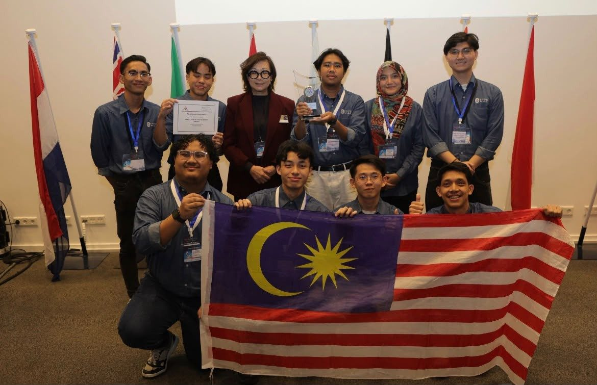
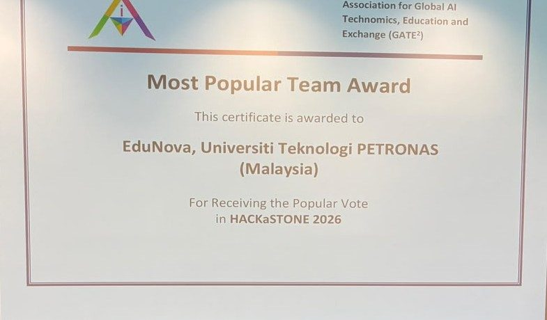
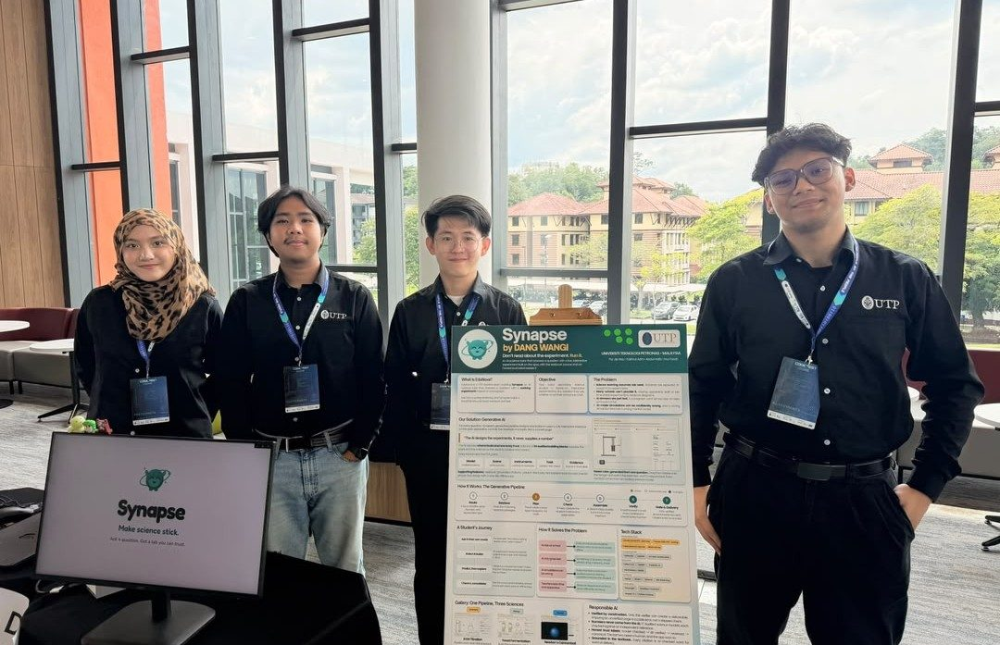
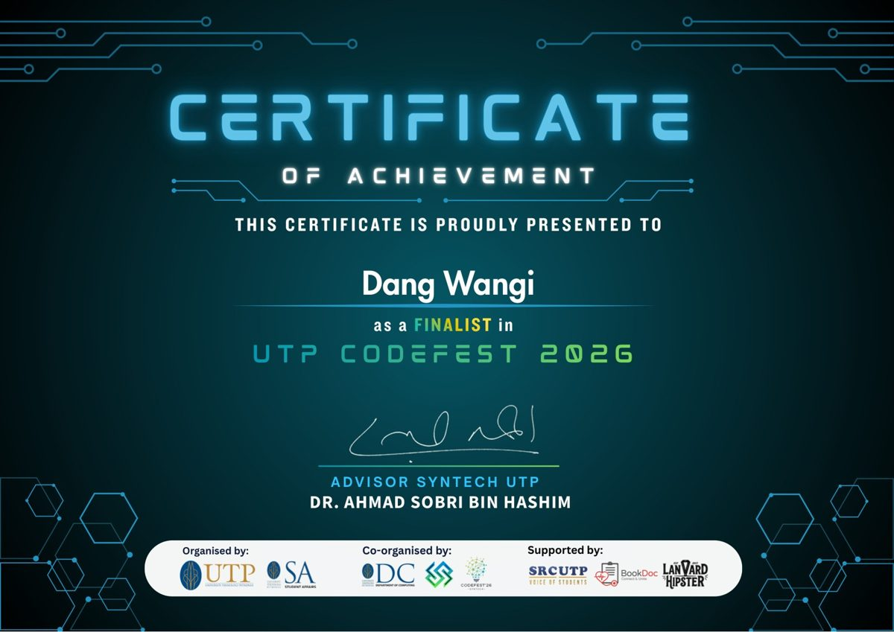
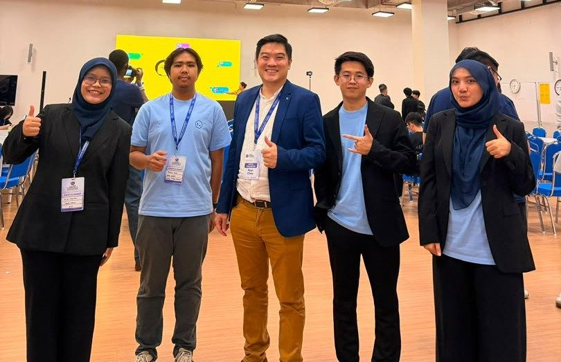
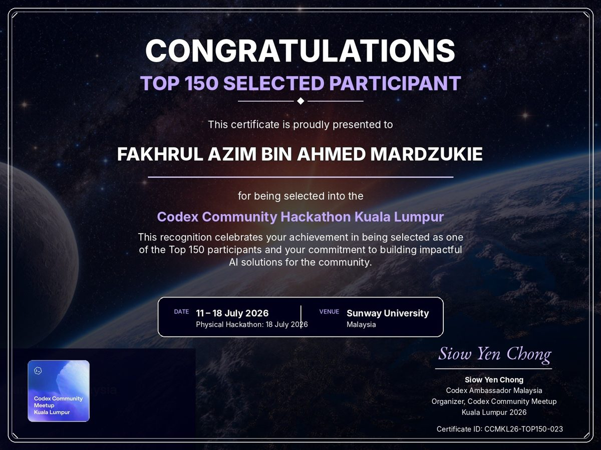
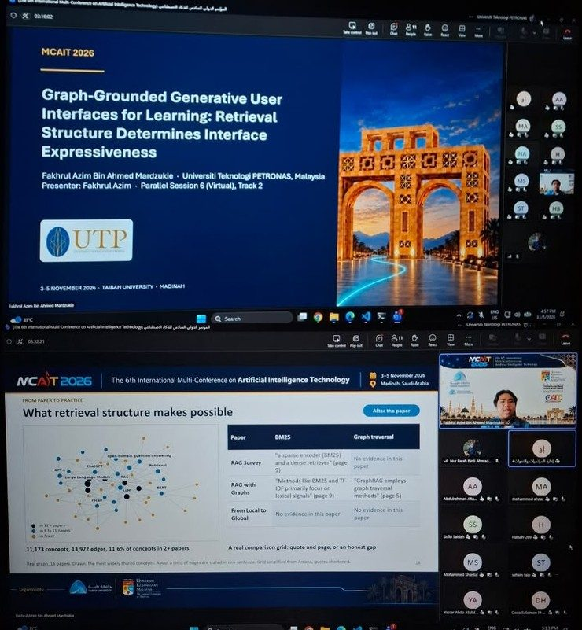
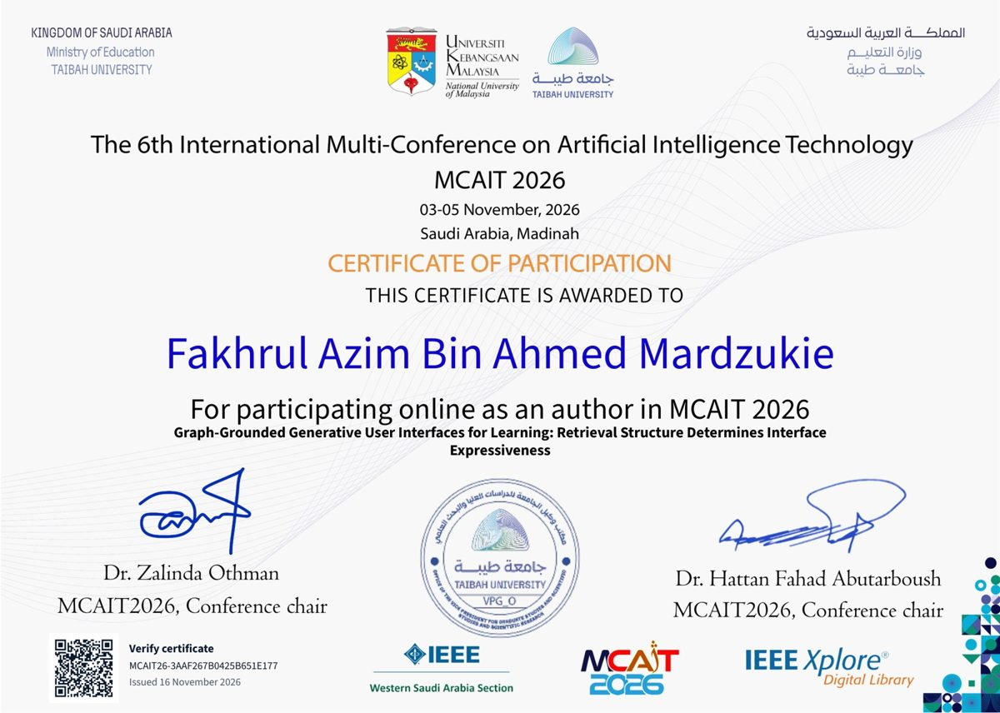

# Achievements

Competitions, publication and recognition from the Final Year Project, Synapse (formerly Arcana). Fakhrul Azim Bin Ahmed
Mardzukie, Bachelor of Computer Science (Hons), Universiti Teknologi PETRONAS.

Team results belong to the teams named. Where a result was not an award, it says so.

## At a glance

| | |
|---|---|
| **Publication** | Sole-author paper accepted and presented at **MCAIT 2026** (international conference) |
| **Award** | **Most Popular Team Award**, hackAstone 2026 Grand Final, Vrije Universiteit Amsterdam (Team EduNova; team record: 5th place overall) |
| **Finalist** | Grand Finalist at hackAstone 2026; **Top 10** Grand Finalist at UTP CodeFest '26; **Top 10** finalist at Codex Community Hackathon KL 2026 (team lead); finalist at the Ministry of Higher Education's Agentic AI Challenge 2026 |
| **Entered** | Top Tech Innovation Awards 2026, three categories |

## Timeline

| Date | Event | What happened |
|---|---|---|
| 18 Jul 2026 | **Codex Community Hackathon KL 2026**, Sunway University (national) | Synapse was selected as one of the Top 150 entries from the open call, and the team reached the **Top 10 finalists** at Demo Day. Team Dang Wangi (5 members), team lead |
| 18 Aug 2026 | **hackAstone 2026**, preliminary round | Shortlisted for the Grand Final |
| 5 Sep 2026 | **MCAIT 2026** | Camera-ready paper approved and accepted |
| 29 Oct 2026 | **hackAstone 2026 Grand Final**, "Agentic AI for Education", Vrije Universiteit Amsterdam (international) | Grand Finalist. Team EduNova (8 members) received the **Most Popular Team Award**, decided by popular vote. The team record is 5th place overall |
| 5 Nov 2026 | **MCAIT 2026**, Parallel Session 6 | Presented the paper (online) |
| 7 Nov 2026 (submitted) | **Top Tech Innovation Awards (TTIA) 2026** (national) | Individual entry, three categories. Participated |
| 9 Nov 2026 (submitted) | **Agentic AI Challenge 2026**, Festival Idea Putrajaya, IPT category (Ministry of Higher Education, national) | Individual entry (the GraphRAG learning engine of the project). Qualified as a finalist and presented at the finals at the Putrajaya International Convention Centre. No award |
| 14 Nov 2026 | **UTP CodeFest '26**, Track 2: Education and Human Development (national) | **Top 10 Grand Finalist** with Team Dang Wangi (4 members), presented at the Grand Finale and received a Certificate of Achievement as a finalist. No award |
| 24 Nov 2026 | **FYP2 viva** | Presented the final project. Slides: [`FYP2-Final/Viva-Presentation/Synapse-FYP2-Viva-FINAL.pdf`](FYP2-Final/Viva-Presentation/Synapse-FYP2-Viva-FINAL.pdf) |

## Pictures

<table>
  <tr>
    <td width="50%"> hackAstone 2026 Grand Final, Amsterdam (Team EduNova)</td>
    <td width="50%"> Most Popular Team Award</td>
  </tr>
  <tr>
    <td width="50%"> UTP CodeFest '26 Grand Finale (Team Dang Wangi)</td>
    <td width="50%"> Certificate of Achievement, finalist</td>
  </tr>
  <tr>
    <td width="50%"> Codex Community Hackathon KL, Demo Day (Team Dang Wangi)</td>
    <td width="50%"> Top 150 selected participant</td>
  </tr>
  <tr>
    <td width="50%"> MCAIT 2026, Parallel Session 6 (online)</td>
    <td width="50%"> Certificate of participation</td>
  </tr>
</table>

## Publication

F. A. B. Ahmed Mardzukie, "Graph-Grounded Generative User Interfaces for Learning: Retrieval Structure Determines
Interface Expressiveness," in *Proc. 6th International Multi-Conference on Artificial Intelligence Technology
(MCAIT 2026)*, Madinah, Saudi Arabia, Nov. 2026. Sole author. Accepted 5 Sep 2026 and presented 5 Nov 2026.

The accepted manuscript is in [`Technical-Paper/`](Technical-Paper/) and the talk materials are in
[`MCAIT/Presentation/`](MCAIT/Presentation/). See [`NOTICE.md`](NOTICE.md) for the IEEE copyright notice.

## Earlier work this project grew from

| When | What |
|---|---|
| Student Industrial Project | **VERA AI**: a hybrid retrieval-augmented assistant built for PETRONAS Upstream, where the limits of flat retrieval first showed. Code: [VERA-AI](https://github.com/Azimlearning/VERA-AI) |

## Where the work is

| | Repository |
|---|---|
| Live demo | [synapse-fyp2-demo.vercel.app](https://synapse-fyp2-demo.vercel.app) |
| The final code | [Synapse-fyp2](https://github.com/Azimlearning/Synapse-fyp2) |
| The version before Synapse | [Arcana-v2](https://github.com/Azimlearning/Arcana-v2) |
| The system the paper describes | [Arcana](https://github.com/Azimlearning/Arcana) (v1, tag `v1.0`) |
| The hackAstone Grand Final entry, frozen | [synapse-hackastone](https://github.com/Azimlearning/synapse-hackastone) |
| The simulation engine, earlier version | [Synapse-v4](https://github.com/Azimlearning/Synapse-v4) |

