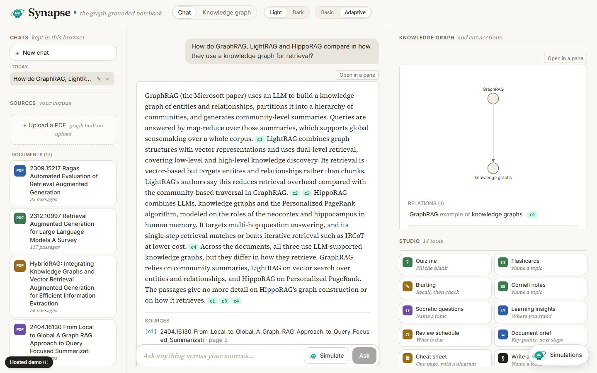
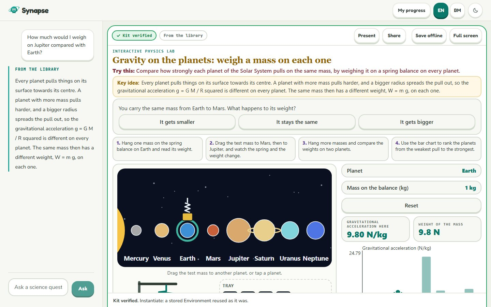
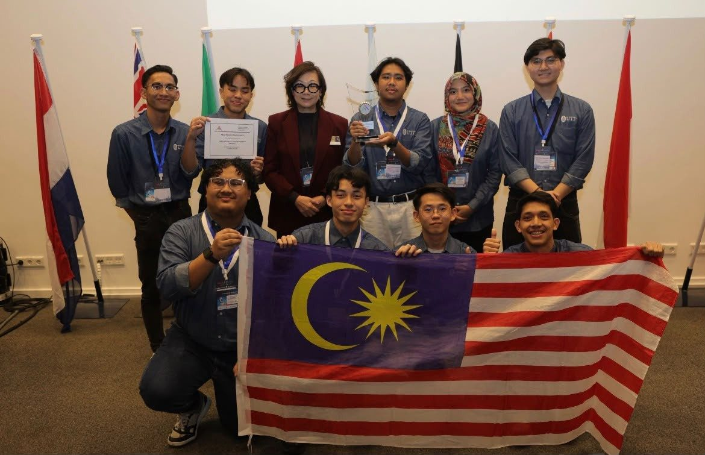
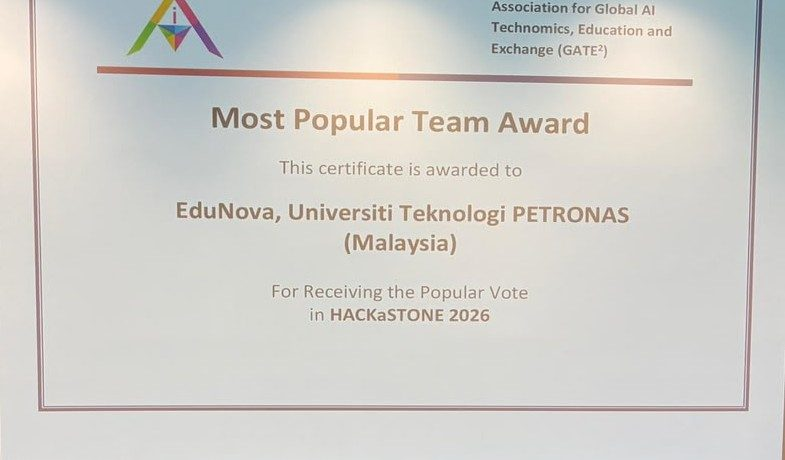
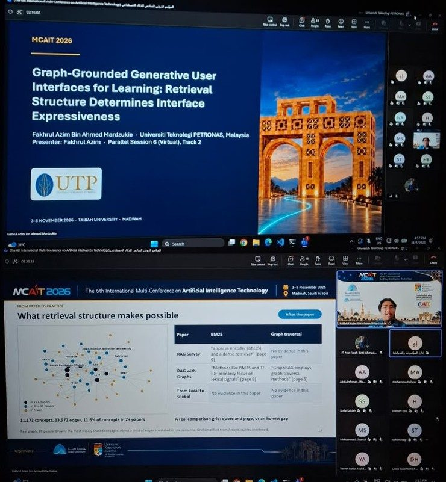
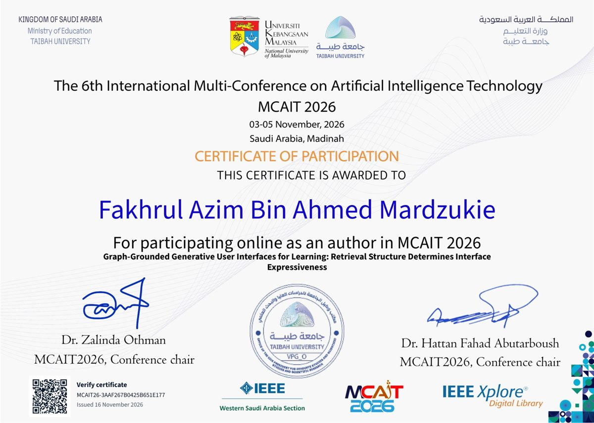
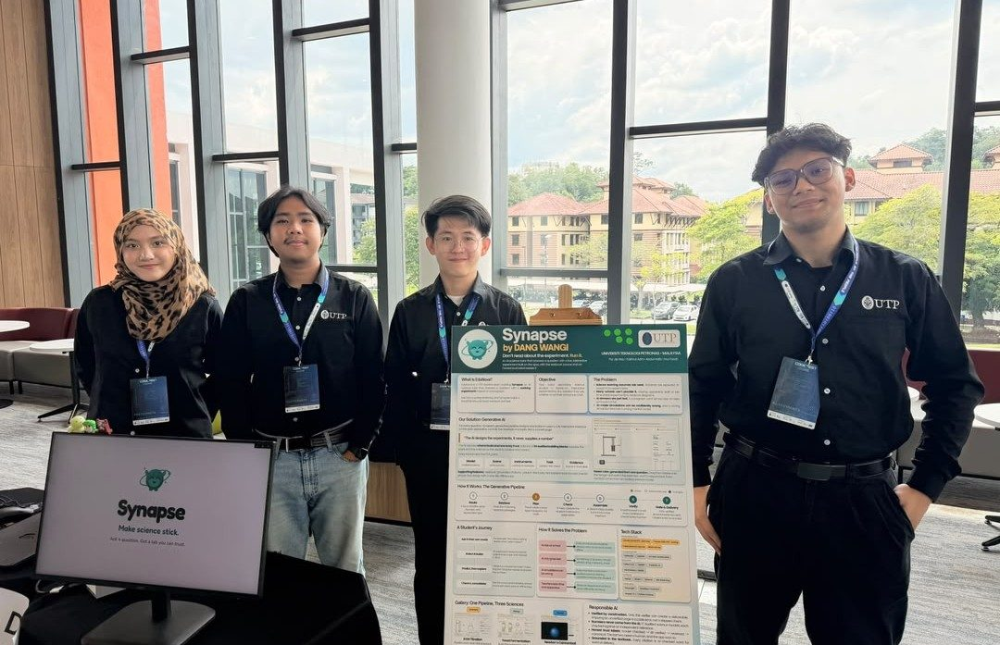
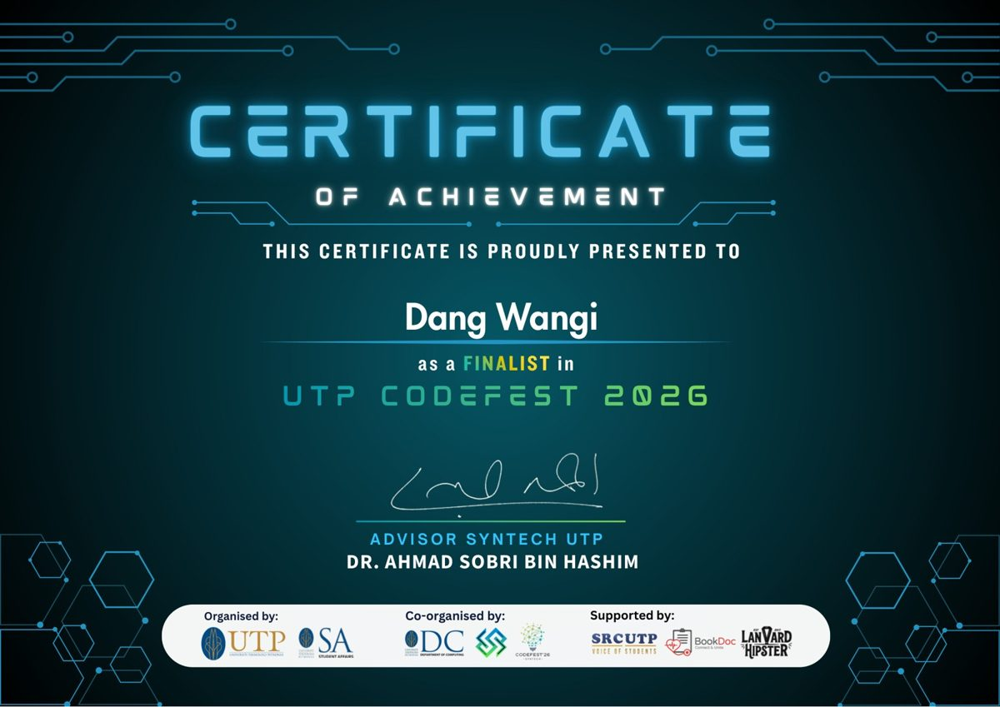
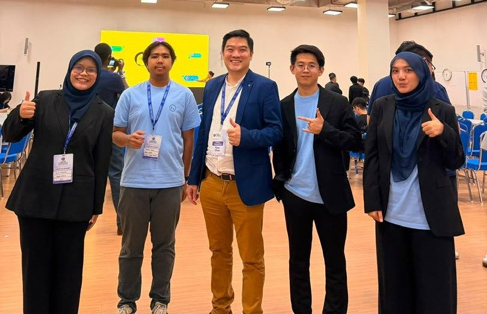
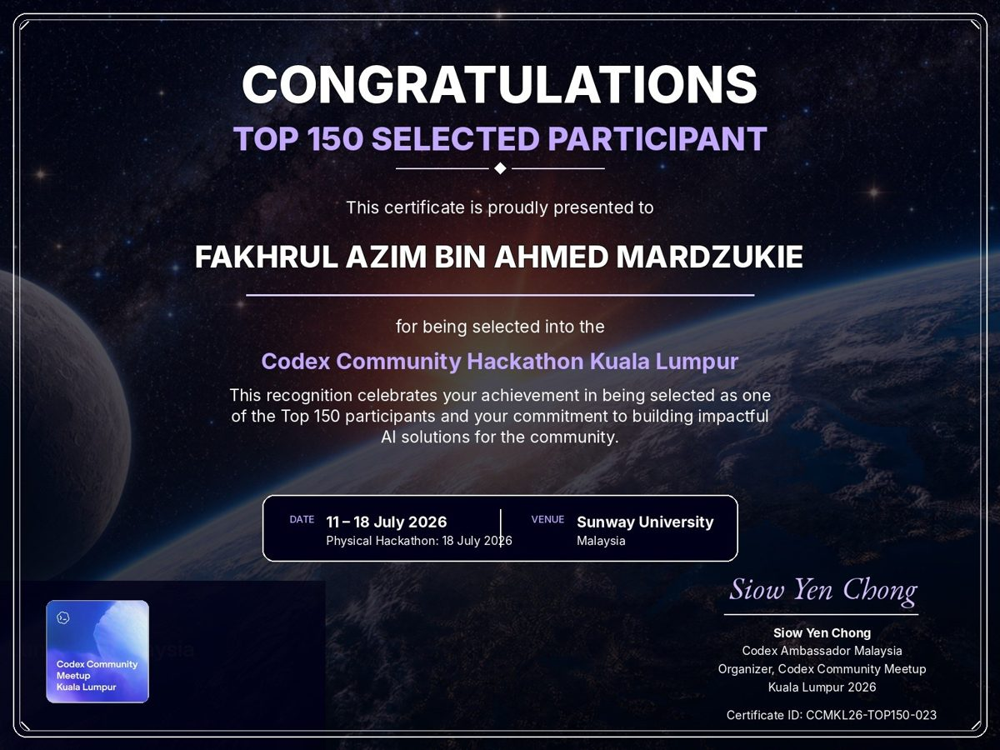

# Synapse (formerly Arcana)

**Ask your papers. See the idea move.** 
The Final Year Project behind a GraphRAG-powered generative UI platform for interactive learning: the paper, the talks, the
viva and the achievements.

  
  
  
  

  
  
  
  
  
  
  

Final Year Project · Bachelor of Computer Science (Hons) · Universiti Teknologi PETRONAS · Fakhrul Azim Bin Ahmed Mardzukie

---

Synapse is a learning workspace for a student's own documents. Documents are read into a knowledge graph beside a vector
index; retrieval fuses graph traversal with dense and sparse signals by rank; and the answer to a question is a composed,
generative interface rather than a stream of prose. Every component is typed, validated before delivery and filled from
retrieved evidence, and for a science question Synapse builds a hands-on simulation tested in a real browser first.

The project began as **Arcana** (FYP1) and became **Synapse** for FYP2. This repository is the public record: the MCAIT 2026
paper and talk, the FYP2 viva slides and the achievements. The code is in
[Azimlearning/Synapse-fyp2](https://github.com/Azimlearning/Synapse-fyp2).

**Try it: [synapse-fyp2-demo.vercel.app](https://synapse-fyp2-demo.vercel.app)**, the real interface replaying answers recorded
from the real system on 16 sample research papers (chat, every Studio tool, the knowledge graph and the simulations).

<table>
  <tr>
    <td width="50%"> <b>Cited answer.</b> Every sentence quotes its source; the graph panel appears because the evidence supports it.</td>
    <td width="50%"> <b>Tested simulation.</b> Drag the mass between planets; the readouts come from an audited science model.</td>
  </tr>
</table>

## Achievements

| | |
|---|---|
| **Publication** | Sole-author paper accepted and presented at **MCAIT 2026**, an international conference |
| **Award** | **Most Popular Team Award**, hackAstone 2026 Grand Final, Vrije Universiteit Amsterdam (Team EduNova; team record: 5th place overall) |
| **Finalist** | Grand Finalist at hackAstone 2026 · **Top 10** Grand Finalist at UTP CodeFest '26 · **Top 10** finalist at the Codex Community Hackathon KL 2026 (team lead) · finalist at the Ministry of Higher Education's Agentic AI Challenge 2026 |
| **Entered** | Top Tech Innovation Awards 2026, three categories |

Team results belong to the teams named; dates, organisers and exactly what each result was are in
[`ACHIEVEMENTS.md`](ACHIEVEMENTS.md).

<table>
  <tr>
    <td colspan="2"><b>hackAstone 2026 Grand Final</b> · Vrije Universiteit Amsterdam · 29 October 2026 · Most Popular Team Award, decided by popular vote</td>
  </tr>
  <tr>
    <td width="55%"></td>
    <td width="45%"></td>
  </tr>
  <tr>
    <td colspan="2"><b>MCAIT 2026</b> · 6th International Multi-Conference on Artificial Intelligence Technology · presented online on 5 November 2026</td>
  </tr>
  <tr>
    <td width="55%"></td>
    <td width="45%"></td>
  </tr>
  <tr>
    <td colspan="2"><b>UTP CodeFest '26</b> · Track 2, Education and Human Development · Grand Finale 14 November 2026 · Top 10 Grand Finalist</td>
  </tr>
  <tr>
    <td width="55%"></td>
    <td width="45%"></td>
  </tr>
  <tr>
    <td colspan="2"><b>Codex Community Hackathon KL 2026</b> · Demo Day at Sunway University · 18 July 2026 · Top 150 selected, Top 10 finalist</td>
  </tr>
  <tr>
    <td width="55%"></td>
    <td width="45%"></td>
  </tr>
</table>

## Publication

> F. A. B. Ahmed Mardzukie, "Graph-Grounded Generative User Interfaces for Learning: Retrieval Structure Determines Interface
> Expressiveness," in *Proc. 6th International Multi-Conference on Artificial Intelligence Technology (MCAIT 2026)*, Madinah,
> Saudi Arabia, Nov. 2026. Accepted and presented on 5 November 2026.

The accepted manuscript and its LaTeX source are in [`Technical-Paper/`](Technical-Paper/). See [`NOTICE.md`](NOTICE.md) for
the IEEE copyright notice.

## Code

| Version | Repository | Status |
|---|---|---|
| **Synapse (FYP2)** | [Azimlearning/Synapse-fyp2](https://github.com/Azimlearning/Synapse-fyp2) | **The final code**, with the [live demo](https://synapse-fyp2-demo.vercel.app) |
| Arcana v2 | [Azimlearning/Arcana-v2](https://github.com/Azimlearning/Arcana-v2) | Frozen: the version before Synapse |
| Arcana v1 | [Azimlearning/Arcana](https://github.com/Azimlearning/Arcana) | Frozen at tag `v1.0`, the system the paper describes |

## What is in this repository

| Folder | Contents |
|---|---|
| [`ACHIEVEMENTS.md`](ACHIEVEMENTS.md) | Competitions, awards and the publication, with dates and exactly what each result was |
| `FYP2-Final/Viva-Presentation/` | The FYP2 viva slides (PDF), presented 24 November 2026 |
| `Technical-Paper/` | The MCAIT 2026 paper: accepted manuscript (PDF), LaTeX source and figures, literature notes |
| `MCAIT/` | The MCAIT 2026 talk: slide decks, plain-language script, slide plan, evidence sources and the build scripts |
| `Concept-Notes/` | Project concept, objectives, personas, scope and key decisions from the proposal stage |
| `concept/` | The original FYP context document and an architecture sketch |
| `proposal defence stuff/` | The proposal defence deck, speaking script and core narrative |
| `Interim-report/Literature-review/` | One note per paper cited in the FYP1 interim report |
| `readme-assets/` | The logo, screenshots, event photos and certificates shown in this README |

This is a curated public subset of the project's working archive. Forms, signed documents and review material are kept private.

## Author

<table>
  <tr>
    <td align="center" width="220"> <b>Fakhrul Azim Bin Ahmed Mardzukie</b> Bachelor of Computer Science (Hons), UTP</td>
    <td>
      <b>Supervisor:</b> Dr Mazeyanti Bt M Ariffin 
      <b>Co-supervisor:</b> AP Dr Noreen Izza Bt Arshad  
      Synapse was presented with Team EduNova at hackAstone 2026 and with Team Dang Wangi at UTP CodeFest '26 and the Codex
      Community Hackathon KL. Team results belong to the teams.
    </td>
  </tr>
</table>

## Licence

The paper in `Technical-Paper/` is © 2026 IEEE (author's accepted manuscript; see [`NOTICE.md`](NOTICE.md)). Event photographs
and certificates belong to their owners and are shown as a record of the results. Everything else is © 2026 Fakhrul Azim Bin
Ahmed Mardzukie.
